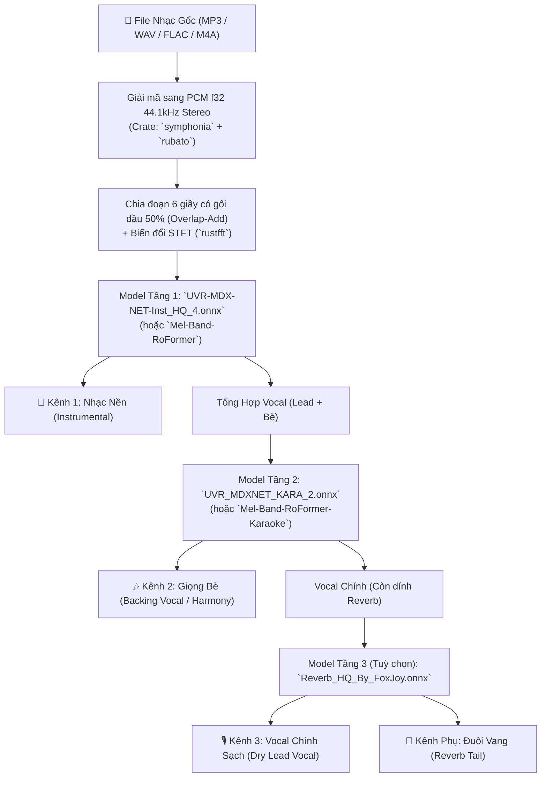
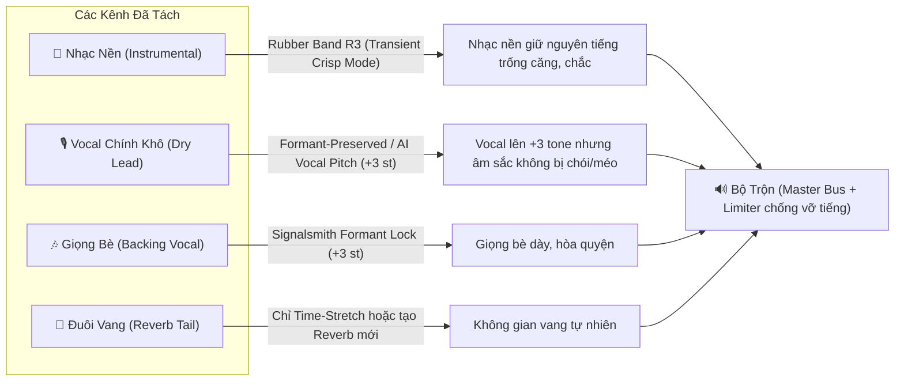

# Kế Hoạch Chi Tiết Phát Triển Ứng Dụng Music Studio (Rust + Local AI)

Tài liệu này là bản thiết kế kỹ thuật chi tiết (Technical Blueprint) cho ứng dụng **Music Studio** viết bằng **Rust**, tập trung vào 2 trụ cột xử lý âm thanh:
1. **Nâng hạ tone (Pitch Shifting) & Chỉnh tốc độ (Time Stretching)** không bị méo tiếng, không bị hiệu ứng "giọng sóc chuột" (chipmunk).
2. **Tách nhạc nền (Instrumental), Vocal chính (Lead Vocal) và Giọng bè (Backing Vocal / Choir)** bằng các mô hình AI mã nguồn mở miễn phí chạy 100% Local.
3. **Giao diện chuyên nghiệp** sử dụng [`nextlevelbuilder/ui-ux-pro-max-skill`](https://github.com/nextlevelbuilder/ui-ux-pro-max-skill).

---

## 1. Chi Tiết Các Model AI Tách Nhạc Chạy Local (Miễn Phí 100%)

Để chạy trực tiếp trong **Rust** mà không phụ thuộc vào Python, ứng dụng sử dụng crate **`ort` (ONNX Runtime Rust Bindings)** kết hợp xử lý phổ tần số **STFT / iSTFT** bằng crate `rustfft` + `ndarray`.

Toàn bộ các model dưới đây đều là **mã nguồn mở miễn phí** từ hệ sinh thái **Ultimate Vocal Remover (UVR5)** / **HuggingFace (`TRvlvr`, `anvuew`, `nomadkaraoke`)**, có sẵn định dạng `.onnx`.

### 1.1. Bảng Danh Mục Model Cụ Thể Theo Từng Nhiệm Vụ

| Nhiệm vụ | Tên File Model (`.onnx`) | Kiến trúc | Chỉ số SDR (Độ sạch) | Dung lượng | Cấu hình phần cứng khuyên dùng |
| :--- | :--- | :--- | :--- | :--- | :--- |
| **1. Tách Nhạc Nền & Tổng Vocal (Chế độ Nhanh / Chuẩn)** | `UVR-MDX-NET-Inst_HQ_4.onnx`<br/>*(hoặc `Kim_Vocal_2.onnx`)* | MDX-Net (Hybrid Time-Frequency U-Net) | ~11.8 dB (Inst)<br/>~10.9 dB (Vocal) | ~56 MB | Chạy mượt trên **mọi CPU** (RAM ≥ 4GB) và GPU tích hợp/rời. |
| **2. Tách Nhạc Nền & Tổng Vocal (Chế độ Siêu Nét - Pro)** | `mel_band_roformer_kim_ft_unwa.onnx`<br/>*(hoặc `bs_roformer_ep_317_sdr_12.97.onnx`)* | Mel-Band / Band-Split RoFormer (Rotary Transformer) | **12.97 – 13.2 dB** *(Top 1 hiện nay)* | ~220 MB – 340 MB | Khuyên dùng **GPU** (DirectML / CUDA / Apple Metal, VRAM ≥ 4GB). |
| **3. Tách Vocal Chính (Lead) & Giọng Bè (Backing/Harmony)** | `UVR_MDXNET_KARA_2.onnx`<br/>*(Chế độ Nhanh)*<br/>`mel_band_roformer_karaoke_aufr33_viperx.onnx`<br/>*(Chế độ Pro)* | MDX-Net Karaoke / Mel-Band RoFormer Karaoke | ~10.2 – 10.8 dB | ~55 MB (MDX)<br/>~228 MB (RoFormer) | Nhận đầu vào là kênh *Tổng Vocal* từ Bước 1 để tách riêng **Lead Vocal** và **Bè**. |
| **4. Tách Đuôi Vang (De-Reverb / De-Echo)** | `Reverb_HQ_By_FoxJoy.onnx` | MDX-Net De-Reverb | ~11.4 dB | ~67 MB | Tách *Vocal Khô (Dry Vocal)* và *Tiếng Vang (Reverb)*. Rất quan trọng để nâng/hạ tone Vocal không bị méo vang. |
| **5. Tách Đa Nhạc Cụ (Mở rộng 4 – 6 Stems)** | `htdemucs_ft.onnx` / `htdemucs_6s.onnx` | Hybrid Transformer Demucs v4 (Meta AI) | ~9.2 dB (Trung bình 6 kênh) | ~160 MB | Tách chi tiết: `Vocals`, `Drums` (Trống), `Bass`, `Guitar`, `Piano`, `Other`. |

---

### 1.2. Thông Số Kỹ Thuật STFT Cụ Thể Để Lập Trình Trong Rust

Khi chạy model `.onnx` bằng Rust, ứng dụng không đưa trực tiếp file MP3 vào model mà phải băm thành phổ tần số **STFT (Short-Time Fourier Transform)** theo đúng thông số của từng model:

#### A. Model `UVR-MDX-NET-Inst_HQ_4.onnx` (Tách Nhạc Nền & Vocal)
- **Tần số lấy mẫu (`sample_rate`):** `44,100 Hz`, Stereo (2 kênh)
- **Kích thước cửa sổ FFT (`n_fft`):** `5120` (Hàm cửa sổ Hann Window)
- **Bước nhảy (`hop_length`):** `1024` mẫu
- **Số bin tần số giữ lại (`dim_f`):** `2560` (cắt các tần số siêu cao trên bin 2560 trước khi đưa vào tensor đầu vào)
- **Số khung thời gian mỗi đoạn (`dim_t`):** `256` frames (~5.94 giây mỗi chunk)
- **Kích thước Tensor đầu vào ONNX:** `[batch_size, 4, 2560, 256]` *(trong đó `4` gồm: Real_Left, Imag_Left, Real_Right, Imag_Right)*
- **Hệ số bù biên độ (`compensate`):** `1.019`
- **Cách lấy 2 kênh:**
  - `Instrumental_Wave = iSTFT(Model_Output) * 1.019`
  - `All_Vocals_Wave = Original_Audio - Instrumental_Wave` *(Phép trừ mẫu đồng pha đảm bảo không mất bất kỳ chi tiết nào)*

#### B. Model `UVR_MDXNET_KARA_2.onnx` (Tách Vocal Chính & Bè)
- **Đầu vào:** Sử dụng luồng `All_Vocals_Wave` vừa tách được ở bước trên.
- **`n_fft`:** `5120` | **`hop_length`:** `1024`
- **`dim_f`:** `2048` | **`dim_t`:** `256`
- **Tensor đầu vào ONNX:** `[batch_size, 4, 2048, 256]`
- **Hệ số bù (`compensate`):** `1.065`
- **Cách lấy Vocal Chính và Bè:**
  - Model dự đoán phần **Backing Vocal (Nhạc Bè)**: `Backing_Vocal_Wave = iSTFT(Model_Output) * 1.065`
  - Phần **Lead Vocal (Vocal Chính)**: `Lead_Vocal_Wave = All_Vocals_Wave - Backing_Vocal_Wave`

#### C. Model `Reverb_HQ_By_FoxJoy.onnx` (Khử Vang Cho Vocal Trước Khi Nâng/Hạ Tone)
- **`n_fft`:** `7680` | **`hop_length`:** `1024`
- **`dim_f`:** `3072` | **`dim_t`:** `256`
- **Công dụng:** Tách `Lead_Vocal_Wave` thành `Dry_Lead_Vocal` (giọng mộc không vang) và `Vocal_Reverb` (đuôi vang).

---

### 1.3. Sơ Đồ Pipeline Tách Nhạc 3 Tầng (Multi-Stage Separation Pipeline)



---

## 2. Chi Tiết Các Model & Thuật Toán Nâng Hạ Tone / Chỉnh Tốc Độ Không Bị Méo

### 2.1. Tại Sao Nâng Hạ Tone Thông Thường Bị Méo Tiếng?
1. **Biến dạng Formant (Hiệu ứng giọng sóc chuột / Chipmunk):** Thanh quản con người có các đỉnh cộng hưởng cố định gọi là *Formant* ($F_1, F_2, F_3$). Khi dịch chuyển toàn bộ phổ tần số lên cao, các đỉnh Formant cũng bị đẩy lên theo, làm giọng nam thành giọng trẻ con/hoạt hình, hoặc hạ tone thì giọng bị ồm như quái vật.
2. **Mất độ nảy của Trống & Nhạc cụ (Transient Smearing):** Thuật toán kéo giãn thời gian (Phase Vocoder cổ điển) làm nhòe pha tại điểm gõ của tiếng trống (Kick/Snare) và tiếng gảy đàn guitar, khiến bài hát nghe bị "nhão" hoặc có tiếng rung kim loại (metallic/phasiness).
3. **Méo đuôi Reverb:** Khi nâng tone cả giọng hát lẫn tiếng vang phòng thu cùng lúc, không gian phòng ảo bị co rút bất thường.

---

### 2.2. Giải Pháp Kết Hợp 3 Engine Mã Nguồn Mở Miễn Phí Trong Rust

Để đạt chất lượng phòng thu (tương đương các phần mềm thương mại đắt tiền như *iZotope RX* hay *Serato Pitch 'n Time*), ứng dụng kết hợp **3 công nghệ mã nguồn mở miễn phí**:

| Chế độ xử lý | Tên Engine / Model Mã Nguồn Mở | Giấy phép | Nguyên lý hoạt động & Ưu điểm | Khi nào sử dụng? |
| :--- | :--- | :--- | :--- | :--- |
| **1. Real-time Polyphonic & Formant DSP (Nghe thử tức thì)** | **Signalsmith Stretch** *(C++11/Rust)*<br/>+ **Rubber Band Library v3.3 (`R3 Finer Engine`)** | MIT / GPLv2 | Phân tách riêng **Bao phổ âm sắc (Spectral Envelope / Formant)** và **Tần số cơ bản ($F_0$)**. Tự động khóa điểm gõ trống (*Transient Lock*) và đồng bộ pha đa dải (*Multi-band Phase Reset*). | Nghe trực tiếp (Real-time 0ms chờ đợi) khi kéo thanh trượt nâng hạ tone (`±12 semitones`) và tốc độ (`0.25x – 2.0x`) trên toàn bài hát hoặc từng kênh. |
| **2. Chuyên biệt cho Vocal: Phân tích – Tổng hợp Giọng Hát** | **WORLD Vocoder (`Harvest` + `CheapTrick` + `D4C`)** | Modified BSD (Miễn phí 100%) | Tách giọng hát thành 3 ma trận độc lập: **Cao độ ($F_0$)**, **Formant thanh quản ($SP$)** và **Hơi thở ($AP$)**. Khi đổi tone chỉ thay đổi $F_0$, giữ nguyên 100% Formant gốc của ca sĩ. | Dùng cho kênh **Lead Vocal** khi người dùng muốn nâng/hạ tone sâu (`±3` đến `±7` nửa cung) mà giữ nguyên chất giọng ca sĩ. |
| **3. AI Neural Vocal Pitch Shifter (Chất lượng Studio Cao Cấp)** | **`RMVPE` (`rmvpe.onnx`)** hoặc **`FCPE` (`fcpe.onnx`)** + **`NSF-HiFiGAN` (`nsf_hifigan.onnx`)** | MIT (Mã nguồn mở từ RVC / DiffSinger) | Dùng AI `RMVPE` dò đường cao độ $F_0$ chính xác tuyệt đối, dịch chuyển $F_0$ sang tone mới và tái tạo sóng âm bằng mạng nơ-ron `NSF-HiFiGAN`. Không hề có hiện tượng méo pha của thuật toán toán học. | Dùng khi xuất file (Render chất lượng cao nhất) cho kênh Vocal. |

---

### 2.3. Bí Quyết Kiến Trúc "Stem-Aware Pitch Shifting" (Nâng Hạ Tone Đa Kênh Thông Minh)

Điểm khác biệt lớn nhất của ứng dụng này so với các app nâng hạ tone thông thường:
Khi một bài hát đã được tách thành **Nhạc nền**, **Vocal chính**, **Bè** và **Đuôi vang (Reverb)**, nếu người dùng bấm nâng tone `+3 Semitones`:



1. **Kênh Nhạc nền (Instrumental):** Áp dụng thuật toán ưu tiên giữ nhịp trống (*Transient-Preserving Polyphonic Stretch*), không cần bật bù Formant để tránh làm đục tiếng đàn Guitar/Piano.
2. **Kênh Vocal chính & Bè:** Bật **100% Formant Preservation** (bảo toàn âm sắc thanh quản) trên phần Vocal khô (*Dry Vocal*), sau đó mới hòa quyện lại với *Reverb*. Kết quả là bài hát dù nâng/hạ 4–5 tone vẫn trong trẻo như bản thu gốc.
3. **Tự động chống vỡ tiếng (True-Peak Limiter):** Khi nâng tone hoặc gộp nhiều kênh, biên độ đỉnh dễ vượt quá `0 dBFS` gây rè tiếng (clipping). Rust Audio Engine sẽ có một tầng **Soft-Knee Limiter (`-0.3 dBFS`)** ở cuối chuỗi xử lý.

---

## 3. Kiến Trúc Dự Án Rust & Tối Ưu Hóa Chống Lag Trên Máy Công Ty (AhnLab)

### 3.1. Nguyên Nhân Gây Lag Máy Công Ty Khi Build/Chạy Rust & Giải Pháp Triệt Để
Trên máy công ty có cài phần mềm bảo mật **AhnLab**, nếu biên dịch hoặc chạy dự án Rust theo cách thông thường sẽ phát sinh hiện tượng treo/lag máy do:
1. Mỗi thư viện có file `build.rs` sẽ khiến Cargo biên dịch và thực thi một file **`build-script-build.exe`** mới tinh (không có chữ ký số). Một dự án lớn có thể sinh ra **30–50 file `.exe`** cùng lúc trên 8–16 luồng CPU, kích hoạt AhnLab quét thời gian thực đồng loạt.
2. Việc gọi các công cụ phụ trợ bên ngoài (như `ffmpeg.exe`, `python.exe`, `ffprobe.exe` dạng sidecar) tạo thêm nhiều tiến trình `.exe` con liên tục.
3. Khi chạy `cargo test` hoặc chia quá nhiều binary nhỏ, trình liên kết (`link.exe`) tạo ra nhiều file `.exe` dung lượng lớn.

> [!IMPORTANT]
> **5 Giải Pháp Kiến Trúc Tối Ưu Chống Quét Nhiều File `.exe` (Áp dụng ngay từ đầu):**
> 1. **Kiến trúc Single-Binary & Không Dùng Sidecar `.exe`:** Toàn bộ ứng dụng chỉ có **1 file `.exe` duy nhất** khi chạy. Tuyệt đối không gọi `ffmpeg.exe` hay `python.exe` bên ngoài mà xử lý giải mã âm thanh hoàn toàn trong bộ nhớ bằng Pure Rust (`symphonia`).
> 2. **Gộp Chung Thành 1 Crate Nội Bộ (Monolithic Library + 1 Binary):** Thay vì tách thành 5–6 crates con hoặc nhiều binary kiểm thử rời rạc, gom toàn bộ logic vào các module (`mod audio_io`, `mod dsp`, `mod ai_separator`, `mod mixer`) trong cùng **1 crate gốc**. Giảm 70% số lượng file trung gian sinh ra trong thư mục `target/`.
> 3. **Ưu Tiên Tuyệt Đối Thư Viện Pure-Rust (Không Có `build.rs`) & Dynamic DLL Có Chữ Ký Số:**
>    - Thay vì biên dịch C/C++ từ mã nguồn qua `cc` hay `cmake` trong `build.rs` (vốn đẻ ra hàng loạt file `.exe` tạm), toàn bộ thuật toán **STFT + Phase Vocoder + Cepstral Formant Preservation (Signalsmith-style)** sẽ được viết bằng **100% Pure Rust** trên nền `realfft` + `ndarray`.
>    - Với **ONNX Runtime (`ort`)**: Sử dụng chế độ **`load-dynamic`** (nạp trực tiếp file `onnxruntime.dll` chính thức đã được **Microsoft ký số Digital Signature**). AhnLab tin cậy ngay file DLL có chữ ký Microsoft nên không quét đi quét lại khi build.
> 4. **Giới Hạn Luồng Biên Dịch Trong `.cargo/config.toml`:**
>    - Đặt `jobs = 2` (hoặc `3`) để Cargo chỉ biên dịch tuần tự từng bước nhẹ nhàng, không bao giờ tạo đột biến hàng chục tiến trình `rustc.exe` / `build-script-build.exe` cùng lúc làm đơ CPU.
> 5. **Chế Độ Phát Triển Giao Diện Không Cần Build `.exe` (UI-Only Mock Mode):**
>    - Khi thiết kế giao diện với `ui-ux-pro-max-skill`, chạy trực tiếp trên trình duyệt qua Vite (`npm run dev`) với bộ giả lập âm thanh WebAudio. Quá trình làm UI không sinh ra bất kỳ file `.exe` nào, máy mượt 100%. Chỉ khi ghép nối hoàn chỉnh mới build bản Rust.

---

### 3.2. Cấu Hình `.cargo/config.toml` Chuẩn Cho Máy Công Ty

```toml
# .cargo/config.toml - Tối ưu hóa chống lag do AhnLab quét tiến trình trên máy công ty
[build]
# Giới hạn số tiến trình rustc.exe / build-script-build.exe chạy đồng thời
# Giúp AhnLab không bị quá tải I/O và CPU vẫn mượt cho các tác vụ văn phòng khác
jobs = 2

[profile.dev]
# Tắt debug info chi tiết cấp độ 2 để giảm dung lượng file .exe từ ~150MB xuống ~15MB
# File .exe càng nhỏ, thời gian AhnLab quét khi khởi chạy càng nhanh (chỉ mất vài ms)
debug = 0
strip = "debuginfo"
opt-level = 1

[profile.dev.package."*"]
# Tối ưu tốc độ chạy cho các thư viện xử lý âm thanh & FFT ngay cả ở chế độ dev
opt-level = 2
```

---

### 3.3. Cấu Trúc Thư Mục Dự Án Tinh Gọn (1 Binary Duy Nhất)

```text
music-studio/
├── .agent/
│   └── skills/
│       └── ui-ux-pro-max/          # Skill UI/UX cài từ nextlevelbuilder/ui-ux-pro-max-skill
├── .cargo/
│   └── config.toml                 # Cấu hình giới hạn jobs & giảm dung lượng .exe tránh lag AhnLab
├── docs/
│   └── IMPLEMENTATION_PLAN.md      # Bản kế hoạch kỹ thuật chi tiết
├── src-tauri/                      # 1 Crate Rust duy nhất (Single Binary)
│   ├── Cargo.toml
│   └── src/
│       ├── main.rs                 # Điểm vào duy nhất của ứng dụng
│       ├── audio_io.rs             # Giải mã MP3/FLAC/WAV/M4A (Pure Rust - symphonia)
│       ├── dsp_pitch_time.rs       # Nâng hạ tone & tốc độ bảo toàn Formant (Pure Rust FFT)
│       ├── ai_separator.rs         # Tách nhạc nền, vocal chính, bè (ort load-dynamic)
│       ├── audio_engine.rs         # Phát nhạc Real-time đa kênh (cpal + rtrb)
│       └── model_manager.rs        # Tự động tải & quản lý cache model .onnx
└── ui/                             # Giao diện Studio (chạy độc lập khi làm UI không tốn .exe)
```

### Danh sách Crates Rust (Đã chọn lọc để hạn chế tối đa `build-script-build.exe`):
- **Giải mã & Xuất âm thanh (100% Pure Rust, không gọi `ffmpeg.exe`):**
  - `symphonia`: Giải mã `MP3`, `WAV`, `FLAC`, `OGG`, `AAC/M4A` thuần Rust.
  - `hound`: Ghi file xuất ra định dạng `WAV` (16/24/32-bit float) thuần Rust.
  - `rubato`: Chuyển đổi tần số lấy mẫu (Resampling về `44100 Hz`) thuần Rust.
- **Phát nhạc thời gian thực & Luồng không khóa:**
  - `cpal`: Giao tiếp âm thanh hệ điều hành (WASAPI trên Windows).
  - `rtrb`: Hàng đợi vòng Lock-free SPSC Ring Buffer thuần Rust.
- **Xử lý phổ & Nâng hạ tone (100% Pure Rust - Không cần biên dịch C++):**
  - `realfft` & `rustfft`: Biến đổi Fourier nhanh (FFT/iFFT) tính toán STFT, Phase Vocoder và **True-Envelope / Cepstral Formant Preservation** ngay trong Rust mà không cần biên dịch thư viện C++ ngoài.
- **Suy luận AI Local (ONNX Runtime Dynamic):**
  - `ort` (với feature `load-dynamic`, `directml`): Liên kết động tới `onnxruntime.dll` và `DirectML.dll` (có chữ ký số của Microsoft), không cần chạy script biên dịch C++ nặng nề.
  - `ndarray` & `rayon`: Xử lý mảng Tensor đa chiều và tính toán song song.

---

## 4. Kế Hoạch Thiết Kế UI/UX Với `ui-ux-pro-max-skill`

### 4.1. Quy Trình Cài Đặt & Tra Cứu Skill Trước Khi Viết Code UI
1. **Bước 1 — Cài đặt Skill:**
   Chạy lệnh khởi tạo vào dự án:
   ```powershell
   npx uipro-cli init --ai antigravity
   ```
   *(Thao tác này tạo cấu trúc `.agent/skills/ui-ux-pro-max/SKILL.md` kèm các script tra cứu dữ liệu thiết kế trong dự án).*
2. **Bước 2 — Kích hoạt & Truy vấn Hệ thống Thiết kế (Design Intelligence):**
   Đọc `.agent/skills/ui-ux-pro-max/SKILL.md` và chạy công cụ tra cứu của skill cho lĩnh vực **Music Production / DAW / Audio Studio**:
   - **Style chủ đạo:** *Dark Mode OLED Studio + Subtle Glassmorphism* (Nền tối sâu `#0B0F17` giúp mắt không mỏi khi làm nhạc lâu, kết hợp các bảng điều khiển kính mờ `backdrop-blur-md` và viền sáng tinh tế).
   - **Bảng màu phân biệt các Kênh (Stem Color Coding):**
     - 🎵 **Master / Original:** Xanh lam điện (`#3B82F6`)
     - 🎙️ **Vocal Chính (Lead Vocal):** Tím Neon / Hồng đào (`#EC4899` / `#A855F7`)
     - 🎶 **Giọng Bè (Backing Vocal):** Vàng Hổ Phách (`#F59E0B`)
     - 🎹 **Nhạc Nền (Instrumental):** Xanh Ngọc Lục Bảo (`#10B981`)
   - **Typography:** Kết hợp font chữ hiện đại dễ đọc (như `Inter` / `Plus Jakarta Sans`) cho giao diện và font Monospace (`JetBrains Mono`) cho các thông số kỹ thuật đòi hỏi độ chính xác cố định (Timecode `00:00.00`, Semitones `+2.0 st`, Cents `+15 ct`, Tempo `100.0%`, BPM `128.0`).

---

### 4.2. Bố Cục Màn Hình Chính (Studio Layout)

```text
+-----------------------------------------------------------------------------------+
| [Logo] MUSIC STUDIO AI        [🎵 Tên_Bài_Hát.mp3 | 124 BPM | Key: Am -> Cm] [⚙️] |
+-----------------------------------------------------------------------------------+
| THANH CÔNG CỤ CHÍNH (MASTER TRANSPORT & PITCH/SPEED DECK)                         |
|  [⏮] [▶️ Play/Pause] [⏹]  01:15.40 / 03:42.00   [🔁 A/B Loop: 01:00 - 01:30]     |
|                                                                                   |
|  +-------------------------------+  +-------------------------------+             |
|  | 🎚️ NÂNG HẠ TONE (PITCH)       |  | ⏱️ TỐC ĐỘ (SPEED / TEMPO)     |             |
|  |  [-]  [ +2 Semitones ]  [+]   |  |  [-]    [ 100.0 % ]     [+]   |             |
|  |  Tinh chỉnh: [ 0 Cents ]      |  |  BPM: 124.0 -> 124.0          |             |
|  |  [x] Bảo toàn giọng (Formant) |  |  [ ] Đổi tốc độ theo cao độ   |             |
|  +-------------------------------+  +-------------------------------+             |
+-----------------------------------------------------------------------------------+
| KHU VỰC RÃNH ÂM THANH & BÀN TRỘN (MULTI-STEM TIMELINE & MIXER)                    |
|                                                                                   |
|  [🤖 Tách Nhạc AI: (•) Nhanh (MDX-Net)  ( ) Siêu Nét (RoFormer) ] [⚡ Bắt đầu tách]|
|  -------------------------------------------------------------------------------  |
|  1. 🎙️ VOCAL CHÍNH   [M] [S]  [====|==] 100%  | ████▄▆█▅▂▁▃▇█▆▃▁ (Waveform)      |
|  2. 🎶 GIỌNG BÈ      [M] [S]  [====|==]  85%  | ▁▁▂▄▆▃▁▁▁▃▅▄▂▁▁▁ (Waveform)      |
|  3. 🎹 NHẠC NỀN      [M] [S]  [====|==] 100%  | ▆▇█▆▅▇█▇▄▅▆▇█▆▅▇ (Waveform)      |
|  4. 🌊 ĐUÔI VANG     [M] [S]  [==|====]  50%  | ▁▂▃▄▃▂▁▁▂▃▂▁▁▂▃▂ (Waveform)      |
+-----------------------------------------------------------------------------------+
| THANH TRẠNG THÁI: [🟢 GPU: DirectML (RTX/AMD/Intel)] [💾 Xuất File (WAV/MP3/Stems)]|
+-----------------------------------------------------------------------------------+
```

### 4.3. Các Tính Năng Trải Nghiệm Người Dùng (UX) Quan Trọng
- **Nghe thử tức thì (Zero-Wait Preview):** Người dùng mở file nhạc lên là có thể bấm Play và kéo thanh **Nâng/Hạ Tone** hoặc **Tốc Độ** nghe kết quả ngay lập tức bằng thời gian thực mà không cần chờ xuất file.
- **Chuyển đổi nhanh các chế độ hát tập / Karaoke (1-Click Presets):**
  - 🎤 **Chế độ Karaoke (Tắt Vocal chính, giữ Nhạc nền + Giọng bè):** Giúp người dùng hát trên nền nhạc vẫn có bè phụ họa như ca sĩ chuyên nghiệp.
  - 🎧 **Chế độ Luyện Bè (Solo Giọng bè + Nhạc nền nhỏ 30%):** Giúp ca sĩ hoặc ban nhạc nghe rõ câu bè để tập theo.
  - 🎙️ **Chế độ Acapella (Chỉ nghe Vocal chính + Bè):** Nghiên cứu cách xử lý giọng của ca sĩ gốc.
- **Tự động nhận diện Tone bài hát (Key Detection) & Hiển thị Tone mới:**
  - Ví dụ: Bài hát gốc ở giọng **La thứ (`Am`)**, khi người dùng bấm `+2 Semitones`, giao diện hiển thị trực quan: **`Am` ➔ `Bm` (Si thứ)** để người chơi nhạc cụ hoặc ca sĩ biết chính xác tone hiện tại.

---

## 5. Lộ Trình Thực Hiện Từng Giai Đoạn (6 Milestones)

| Giai đoạn | Hạng mục công việc | Đầu ra nghiệm thu (Deliverables) |
| :--- | :--- | :--- |
| **Giai đoạn 1: Khởi tạo & UI/UX Design System** | 1. Cài đặt `nextlevelbuilder/ui-ux-pro-max-skill`.<br/>2. Khởi tạo dự án Single-Binary Rust + Tauri v2.<br/>3. Áp dụng `ui-ux-pro-max-skill` dựng hệ thống Design Tokens và khung giao diện Studio (chạy trên Vite dev server không tạo file `.exe` dư thừa). | Giao diện Studio hoàn chỉnh, hiển thị sóng âm 60fps và bảng điều khiển Tone/Tốc độ/Mixer. |
| **Giai đoạn 2: Core Audio & Real-time Playback** | 1. Viết module `audio_io` (`symphonia`) đọc mọi định dạng nhạc.<br/>2. Viết module `audio_engine` (`cpal` + `rtrb`) phát đa kênh đồng bộ tuyệt đối (Sample-accurate multi-stem sync) với nút Mute/Solo/Volume. | Mở nhạc, phát/tạm dừng, tua mượt mà, trộn nhiều kênh âm thanh đồng thời không trễ. |
| **Giai đoạn 3: Engine Nâng Hạ Tone & Tốc Độ** | 1. Tích hợp thuật toán Spectral Phase Vocoder + Cepstral Formant Preservation vào module `dsp_pitch_time`.<br/>2. Bật bảo toàn Formant giọng hát.<br/>3. Thêm thuật toán nhận diện Tone bài hát (Chromagram Key Detector). | Kéo thanh trượt Tone (`±12 semitones`) và Tốc độ (`0.25x – 2.0x`) nghe trực tiếp không bị méo giọng, không vỡ tiếng. |
| **Giai đoạn 4: Trình Quản Lý Model AI (Model Manager)** | 1. Xây dựng module `model_manager` tải tự động các model `.onnx` từ HuggingFace (có thanh tiến trình, tạm dừng/tiếp tục, kiểm tra SHA256).<br/>2. Cho phép người dùng nhập file `.onnx` có sẵn từ máy tính. | Giao diện quản lý model rõ ràng, tải về một lần và dùng offline vĩnh viễn. |
| **Giai đoạn 5: Engine AI Tách Nhạc Nền, Vocal & Bè** | 1. Xây dựng pipeline STFT/iSTFT + Overlap-Add trong module `ai_separator`.<br/>2. Tích hợp `ort` (`load-dynamic`) với tăng tốc GPU (`DirectML`/`CUDA`) và CPU.<br/>3. Kết nối chuỗi 3 model: *Tách Nhạc nền* ➔ *Tách Vocal chính & Bè* ➔ *Khử Reverb*. | Bấm 1 nút tách bài hát thành 3–4 rãnh riêng biệt, tự động đưa lên Multi-Stem Mixer để nghe và nâng/hạ tone độc lập từng rãnh. |
| **Giai đoạn 6: Xuất File (Export) & Tối Ưu Hóa** | 1. Cho phép xuất bản phối tổng (Master Mix) hoặc xuất rời từng kênh đã nâng/hạ tone ra `WAV` (24-bit), `FLAC`, `MP3`.<br/>2. Tích hợp AI Vocal Pitch (`RMVPE` + `WORLD`/`NSF-HiFiGAN`) khi render chất lượng cao. | Hoàn thiện toàn bộ tính năng, đóng gói bộ cài ứng dụng độc lập (`.msi` / `.exe`). |
